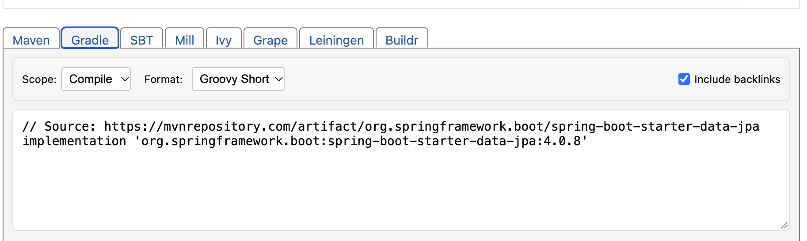

# springsource

자바 수업내용 요약.

## 클로드로 이해하기

- 링크 참고
- claude.ai/artifact/CVKwjxUD2g5DsPW6yyVf6u

## 그냥 결론적으로 자바도 기본 엔지니어링은 똑같음

- 1 - 화면단에서 요청이 옴.
- 2 - 화면단요청(req) 하면 컨트롤러 응답(res)(API 이용)
- 3 - 컨트롤러는 필요한걸 서비스에서 꺼내옴 (일반적으로 CRUD 함수)
- 4 - 서비스는 CRUD 함수를 정의해야 하는데, 데이터베이스를 건드리는데 있어서 Repository가 필요함. (Repository에는 findAll, getId 같은게 미리 있어서 그냥 생성한 후 점찍으면 나옴.)
- 5 -리파지토리는 이걸 Entity에 정의된 형식대로 뱉어버림
- 6- 이제 화면단으로 가져가면 끝? 인데 자바는 그냥 못보내줌, 처리 한번 해야함. 이게 Dto임.

#### Dto 이놈이 그래서 뭐임?

- 몰루 객체라는데 뭐 Entity로 나가면 위험하대 보안상 문제가 있대.
- 막 엔티티는 그냥 나가버리면 뭐 비밀번호 유출이 어쩌고 저쩌고 이러니까 그냥 Dto라는 객체 만들어서 보내야 함.
- 그래서 서비스가 DB에서 엔티티 형태로 부른걸 Dto로 바꿔서 내보내고, Dto로 받은걸 Entity로 바꿔서 DB에 저장함.

# 결론

- 걍 다 똑같다. ㅇㅇ
- 화면에서 요청 -> 컨트롤러가 받음.
- 컨트롤러는 CRUD를 -> 서비스에 요청
- 서비스는 DB에서 데이터 필요하니까 -> 리파지토리 이용.
- 리파지토리에서 나온애들은? Entity 타입
- Entity 타입나왔으니까 서비스는 ? -> Dto로 바꿔줌.
- Dto가 나오면? 컨트롤러가 화면에 쏴줌
- 화면단은 이걸 받고 끝.

#### ##### 근데 이제 여기서 막 이런거 다 구현하려면 답이 없으니까 이상한 막 패키지 같은거 받는거임

@Component, @Controller, @Service, @Repository @Bean -> 이런거 쓰면,
Students students = new Students() 이렇게 생성자 할 필요도 없고, 그냥 알아서 스프링부트가 객체관리함. 개꿀~

그리고 막 롬복 라이브러리에 들어있는놈 쓰면
@Getter, @Setter, @NoArgsConstructor, 이런것들 그냥 NoArgs는 그말대로 아무 파라미터도 없는 생성자 내가 작성 안해도 되고, AllArgs는 전부 세팅해야하는거 기본적으로 생성자 직접 작성 안해도 되게끔 ㅇㅇ

```java

@NoArgsConstructor
@AllArgsConstructor
@Builder
@ToString
@Setter
@Getter
```

이런거 뭐 그냥 매번 붙이는게 편하다~ Entity위에 ㅇㅇ..

그리고 뭐 또 정보? 같은거라면 gradle/wrapper 폴더 보면 .jar 이런거 있자늠

이 자르 파일이 뭐냐면 그냥 자바 압축파일 형식임 ㅇㅇ

예전엔 웹개발 할때 war고, 일반 데스크탑 어플리케이션 개발할땐 jar 썼는데, 요즘은 그냥 죄다 jar 쓰는 추세임 ㅇㅇ

자세한건? 모름.

아 그리고 [mvnrepository.com](https://mvnrepository.com/)
저기 가면 이제 npm마냥 필요한 패키지 다운받을 수 있는데



요렇게 생긴거 그레들 클릭하고

이제 그걸 build.gradle에 다가

```groovy
dependencies {
	implementation 'org.springframework.boot:spring-boot-starter-data-jpa'
}
```

이런식으로 넣으면 패키지 설치가 완료됨 ㅇㅇ.
